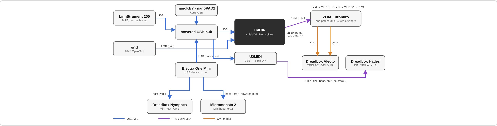
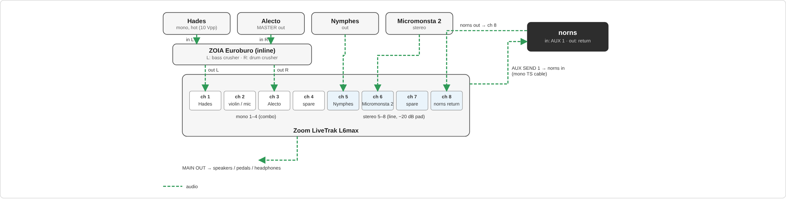

# S.C.I.E.N.C.E.

**South Central Indiana Electro Noise Circuit Experiment**: a norns + grid instrument, short name **sci**. 

sci records LinnStrument MPE performances as editable loops, keeping every note's bend, slide and pressure. Each MIDI loop is paired with an audio loop, and both run on a Reels-style tape transport you can brake, reverse and varispeed. Around that it adds an RC-505-style looper page, a live quantize page, two trigger lanes for a Dreadbox Alecto, and 16 save slots. A Korg nanoKEY plays the bass, and a nanoPAD2 plays and records the drums.

> **Status:** every feature runs in a simulated norns (see [Testing](#testing)) but hasn't been played on hardware yet. Expect a tweak or two on the first run, and please open an issue if something misbehaves.

**Contents:** [What it does](#what-it-does) · [Install](#install) · [Quick start](#quick-start) · [Controls](#controls) · [The rig](#the-rig) · [Controllers](#controllers) · [Docs](#docs) · [Known limits](#known-limits) · [Testing](#testing) · [Project layout](#project-layout) · [Credits](#credits)

## What it does

- **4 paired tracks.** Each track has an MPE MIDI loop and an audio loop (softcut). All tracks share one loop length of 1 to 8 bars.
- **MPE kept whole.** Notes are recorded per finger with their pitch bend, slide (Y) and pressure, then replayed on the synth's member channels. Bends are rescaled if the LinnStrument and the synth use different bend ranges.
- **Tape transport.** Varispeed from ¼× to 2×, reverse, brake (a tape stop with a pitch dive), flutter, and resync on the beat. The tape can drive the MIDI, the audio, or both, so you can mangle one and keep the other in time.
- **Print.** Record a track's MIDI loop, as played by the synth, into its audio loop for one lap. Then change the patch and play something new on top.
- **Six grid pages**, cycled with row 7 key 8:

  | Page | What it's for |
  |---|---|
  | **MIDI** | Note editor: tap to add or delete, hold and tap to set length, hold a key and play to step-record |
  | **AUDIO** | Record, overdub, print MIDI → audio, levels, per-track MIDI and audio mutes |
  | **LOOP** | RC-505-style strips: REC → DUB → PLAY, STOP, fader, FX, reverse, fade |
  | **QUANT** | Launch quantize, note quantize, and which part the tape drives |
  | **DRUM** | Two polymetric 16-step trigger lanes for the Alecto, with accents and recorded velocity |
  | **SAVE** | 16 slots holding MIDI, audio, drums and settings |

- **Undo everywhere.** MIDI passes, grid edits, drum edits and audio recordings can all be undone.
- **On-screen guide.** The norns screen shows page tabs, a cheat sheet for the current page, and the name of every grid key you press. Tap K1 for the reels view.

## Install

**From maiden or a USB stick:** copy `sci.lua` to `dust/code/sci/sci.lua`, then choose **sci** from SELECT.

**From a norns terminal:** clone the repo into a folder called `sci` so it shows up tidily in the menu:

```
cd ~/dust/code && git clone https://github.com/Goosegoosegoosegoosegoose/S.C.I.E.N.C.E. sci
```

Requirements: norns (tested against the shield XL Pro layout) and a 16×8 monome-compatible grid. A LinnStrument or any MPE controller is the main input; everything else is optional.

Saves go to `dust/data/sci`. Saves from the older `mpecap` script move there on first run.

**First-time setup:**

1. SYSTEM → DEVICES → MIDI: assign your controllers and synths (LinnStrument, Electra Controllers, U2MIDI, nanoKEY2, nanoPAD2, and the shield's TRS MIDI port).
2. SYSTEM → AUDIO: turn **monitor** all the way down, or you'll hear inputs twice.
3. In PARAMS, check each track's **synth out** and member channels. sci finds the defaults by device name.

## Quick start

1. **A MIDI loop.** Select track 1 (row 8 key 5) and set a 4-bar loop (row 8 key 12). Press REC (row 8 key 1, or K2) and play. Each note joins the loop when you lift your finger. Keep playing to overdub; UNDO (row 8 key 3) removes the last pass.
2. **Edit it.** On the MIDI page, tap a note to delete it, tap an empty key to add one, or hold a note and tap further right to change its length.
3. **Mangle the tape.** Hold BRAKE (row 7 key 3) for a tape stop, press REVERSE (row 7 key 1), or pick a speed on row 7 keys 9–16. RESYNC (row 7 key 5) snaps back to 1× on the beat.
4. **An audio loop.** Go to the LOOP page and press track 2's big button: REC, then DUB, then PLAY.
5. **A beat.** On the DRUM page tap steps on rows 1 and 4, hold a step for an accent, or press REC and play the nanoPAD2.
6. **Perform.** On the QUANT page set launch quantize to a bar, and set the tape to drive audio only. Your MIDI keeps time while you brake and reverse the audio.
7. **Save.** On the SAVE page pick a slot on row 1 and hold SAVE (row 2 key 1) for a second.

## Controls

Rows 7 and 8 are the same on every page.

| Row | Keys |
|---|---|
| **7 · tape** | 1 REVERSE · 3 BRAKE (hold) · 5 RESYNC · 6 FLUTTER · 8 PAGE · 9–16 speed ¼× ½× ⅔× ¾× 1× 4⁄3× 3⁄2× 2× |
| **8 · main** | 1 REC · 2 PLAY · 3 UNDO · 4 CLEAR (hold) · 5–8 TRACK 1–4 · 9–16 loop length 1–8 bars |

| norns | Does |
|---|---|
| K1 (tap) | Guide view ↔ reels view |
| K2 / K3 | REC (acts on the current page) / PLAY |
| K1+K2 / K1+K3 | UNDO / RESYNC |
| E1 / E2 / E3 | Flutter / loop length / speed |
| K1+E3 | Scroll the MIDI editor's pitch |

The full grid layout for every page is in the [manual](docs/sci-manual.pdf).

## The rig

sci was built for this setup, but every port, channel and note is a PARAMS setting, so other gear works too.

| Part | Role |
|---|---|
| LinnStrument 200 | MPE input |
| norns shield XL Pro + 16×8 grid | runs sci |
| Electra One Mini | routes norns to the Nymphes (host Port 1) and Micromonsta 2 (host Port 2) |
| Dreadbox Nymphes, Micromonsta 2 | MPE synths on tracks 1 and 2 |
| Dreadbox Hades | mono bass on track 3, through a U2MIDI (USB → 5-pin DIN) on channel 2 (DIP switch 3 on) |
| ZOIA Euroburo | turns channel 10 notes 36/38 into TRIG and VELO for the Alecto; crushes both synths' audio inline |
| Dreadbox Alecto | drums from the DRUM page; audio through ZOIA in R |
| Korg nanoKEY / nanoPAD2 | bass keys / drum pads and X-Y pad |
| Zoom LiveTrak L6max | mixer; ZOIA out L/R on ch 1/3, AUX 1 feeds the norns |

**MIDI and CV**



**Audio**



### Default tracks

| Track | Synth | Port | Channels |
|---|---|---|---|
| 1 | Nymphes | Electra Controller 1 | 2–7 (MPE) |
| 2 | Micromonsta 2 | Electra Controller 2 | 2–7 (MPE) |
| 3 | Hades | U2MIDI | 2 (mono) |
| 4 | spare | Electra Controller 1 | 2–7 |
| DRUM | Alecto via ZOIA | shield TRS MIDI out | 10, notes 36 and 38 |

On a one-channel track like the Hades, live thru moves your notes onto its channel and drops pitch bend.

## Controllers

- **LinnStrument:** normal MPE layout, member channels 2–7. Match sci's two bend-range settings to the LinnStrument and the synth.
- **nanoKEY:** plays track 3 (the Hades) by default, or any track or the selected one. It records when that track is recording, and step-records with a held grid key. Its mod wheel and pitch bend pass through to the track. Set the nanoKEY to channel 10 and its keys play the ZOIA directly.
- **nanoPAD2:** pads 36 and 38 play the two Alecto lanes. With REC on the DRUM page, each hit lands on the nearest step and replays at the velocity you played. X-Y pad moves pass to the ZOIA on channel 10 and are recorded with the hits. Switch the **pads** setting to *tuned* to send every pad note straight to the ZOIA, for the CV guide's tuned-pad layout.

## Docs

| Document | What's in it |
|---|---|
| [sci manual (PDF, 13 pages)](docs/sci-manual.pdf) | Wiring, ZOIA patch, quick start, every grid page, PARAMS, troubleshooting, how the code works. Source: [`docs/source/sci-manual.html`](docs/source/sci-manual.html), printed to landscape Letter. |
| CV and Patching Guide: Dreadbox Alecto and Hades ([markdown](docs/guides/cv-patching-guide-alecto-hades.md) · [PDF](docs/guides/cv-patching-guide-alecto-hades.pdf)) | CV basics, the Alecto patchbay, the Hades, patches between them, a ZOIA crash course, and the nanoPAD2/nanoKEY layouts sci supports |
| ZOIA Euroburo Patch Build ([markdown](docs/guides/zoia-euroburo-patch-build.md) · [PDF](docs/guides/zoia-euroburo-patch-build.pdf)) | Cable list, MIDI plan, and a module-by-module build of the ZOIA patch sci's defaults expect |
| [Code walkthrough (PDF)](docs/sci-code-walkthrough.pdf) | What each section of `sci.lua` does |
| [CHANGELOG](CHANGELOG.md) | Build history |

The manual's wiring and ZOIA pages match the two guides. Where they ever differ, trust the guides: they're written from the Dreadbox, Empress and Korg manuals.

## Known limits

- Audio is mono, up to 55 s per loop (8 bars at about 35 bpm).
- All tracks share one loop length. Changing bars or tempo after recording audio misaligns it; SAVE/LOAD restores both.
- Audio undo is one step (press again to redo).
- Drums run on the clock and don't follow the tape's speed or direction.
- Tuned nanoPAD2 pads and a nanoKEY on channel 10 play live but aren't recorded.
- The Hades is mono and plays C-1 to C4.
- The Electra One Mini's USB host takes two devices, so it's full with the Nymphes and Micromonsta 2.
- Not yet tested on hardware.

## Testing

`tests/harness.py` is a small simulated norns. It fakes the clock, params, MIDI, grid, screen, softcut and files, runs `sci.lua` in a real Lua interpreter (through [lupa](https://github.com/scoder/lupa)), and plays test scripts against it.

```
pip install lupa
./tests/run_tests.sh
```

Each test prints what it checked (notes sent, LED states, saved data) and fails if the script raises an error. Run one test on its own with:

```
python3 tests/harness.py sci.lua tests/korg_controllers.lua
```

**When editing `sci.lua`:** Lua allows at most 200 local names at the top level of a file, and sci is at about 190. Put new helpers in a table (as `UI` and `CTL` do) instead of adding top-level locals. Also keep `grid_redraw` and `g.key` below all the page functions they call.

## Project layout

```
sci.lua                  the script
docs/
  sci-manual.pdf         the manual
  source/                manual source (HTML)
  guides/                CV guide and ZOIA build guide (markdown + PDF)
  images/                wiring diagrams
  sci-code-walkthrough.pdf
tests/
  harness.py             simulated norns
  run_tests.sh           runs every test
  *.lua                  one test per feature
CHANGELOG.md
```

## Credits

Built by S.C.I.E.N.C.E. in south central Indiana. Inspired by **Reels** (the norns tape script) and the **BOSS RC-505mk2** workflow; no code from either is used.

No license has been chosen yet, so all rights are reserved for now. Ask before reusing the code.
