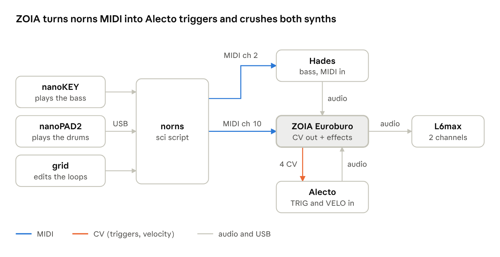

# ZOIA Euroburo Patch Build: norns sci to Alecto and Hades

Nov 10, 2026 · goose

You play the nanoKEY and nanoPAD2 into norns, sci records and replays them, and the ZOIA does two jobs: it turns the drum notes into trigger and velocity voltages for the Alecto, and it runs both synths through a bit crusher and a decimator.

This is a build guide, not a patch file. You place about eight modules by hand, which is also the fastest way to learn the ZOIA. Steps follow the Euroburo manual for firmware 2.30; on-screen wording may differ slightly on other firmware.

## At a glance

rig wiring · 8 devices, 3 kinds of cable

The Hades takes MIDI directly. The Alecto has no MIDI, so its notes go to the ZOIA and come out as four voltages. Both synths' audio passes through the ZOIA on the way to the mixer.

## Cables and connections

| \#  | From                       | To                         | Cable                 | Carries                |
|-----|----------------------------|----------------------------|-----------------------|------------------------|
| 1   | nanoKEY, nanoPAD2, grid    | norns USB ports (or a hub) | USB                   | Your playing           |
| 2   | norns, through your U2MIDI | Hades MIDI in              | USB to 5-pin DIN      | Bass notes, channel 2  |
| 3   | norns shield TRS MIDI out  | ZOIA MIDI in               | 3.5 mm TRS            | Drum notes, channel 10 |
| 4   | ZOIA CV out 1              | Alecto TRIG 1              | 3.5 mm mono           | Voice 1 trigger        |
| 5   | ZOIA CV out 2              | Alecto TRIG 2              | 3.5 mm mono           | Voice 2 trigger        |
| 6   | ZOIA CV out 3              | Alecto VELO 1              | 3.5 mm mono           | Voice 1 velocity       |
| 7   | ZOIA CV out 4              | Alecto VELO 2              | 3.5 mm mono           | Voice 2 velocity       |
| 8   | Hades audio out            | ZOIA audio in L            | 6.3 mm to 3.5 mm mono | Bass audio             |
| 9   | Alecto MASTER              | ZOIA audio in R            | 3.5 mm mono           | Drum audio             |
| 10  | ZOIA audio out L           | L6max channel              | 3.5 mm to 6.3 mm mono | Crushed bass           |
| 11  | ZOIA audio out R           | L6max channel              | 3.5 mm to 6.3 mm mono | Crushed drums          |

Three things to know about the MIDI cables:

- **The ZOIA manual describes no MIDI thru.** That is why the Hades gets its own feed (cable 2) instead of being chained after the ZOIA.

- **TRS MIDI comes in two wirings, Type A and Type B.** The ZOIA is Type A. If cable 3 does nothing, your shield's jack may be the other type. In that case use one of the ZOIA's included TRS-to-DIN dongles and feed it from a DIN source.

- **Plugging into an Alecto TRIG jack turns off that voice's own sequencer.** That is what you want here: norns is the sequencer now.

Power the ZOIA in its case or with a 9 to 12 V centre-negative supply of at least 300 mA.

## MIDI plan

| Part           | Played from | MIDI channel | Notes                 | Goes to                      |
|----------------|-------------|--------------|-----------------------|------------------------------|
| Hades bass     | nanoKEY     | 2            | Any, within C-1 to C4 | Hades, via the U2MIDI        |
| Alecto Voice 1 | nanoPAD2    | 10           | 36 (C1) only          | ZOIA, then TRIG 1 and VELO 1 |
| Alecto Voice 2 | nanoPAD2    | 10           | 38 (D1) only          | ZOIA, then TRIG 2 and VELO 2 |

- **Hades channel.** The Hades listens on all channels unless you set its internal DIP switch. Switch 3 on sets channel 2. If you would rather not open it, leave it on OMNI and make sure sci sends only the bass track to the U2MIDI port.

- **Notes 36 and 38** are the usual kick and snare notes. Check which pads send them with the Korg Kontrol Editor, and set the nanoPAD2 to the channel sci expects.

- **The Hades tracks five octaves,** C-1 to C4. Notes outside that range will not play correctly.

## ZOIA in five minutes

The ZOIA is a modular synth inside one box. You already know the idea from the Alecto and Hades: outputs go to inputs. The only difference is that the cables are virtual.

- **Modules live on the button grid.** Each module takes up a few buttons in a row. Each button is one input, output or setting of that module.

- **To place a module,** press an empty button, pick a category, pick the module, set its options and choose "Done?".

- **To connect two buttons,** hold both at the same time. That is your patch cable.

- **To set how strong a connection is,** turn the knob right after making it. This is the attenuator the Alecto and Hades lack.

- **To set a value by hand,** press a button and turn the knob.

- **To change a module's options later,** select it and press Edit.

- **Pages** give you more grid. Page Left and Page Right move between them. To connect across pages, press the first button, change page, then press the second.

- **The jacks have their own buttons.** On the Euroburo, the audio ins and outs, the four CV ins and the four CV outs each have a button beside the jack. These are always there; you connect to them like any other button.

- **Save** stores the patch in the ZOIA's internal memory. Save often.

- **Help** shows a short description of whatever you have selected.

Inside the ZOIA, control signals run from 0 to 1. Each CV out jack then scales that to real volts. You choose the scale per jack: 0 to 5 V, 0 to 10 V or -5 to 5 V.

Start from an empty patch slot (see "Patches" in the ZOIA manual for choosing one).

## Build page 1: MIDI to Alecto triggers

This page holds two copies of one module, Midi Notes In. Each copy listens for a single drum note and produces a trigger and a velocity.

### Step 1: place the Voice 1 listener

1.  Press the top-left grid button.

2.  Choose the Interface category, then **Midi Notes In**.

3.  Set its options:

| Option          | Set to       | Why                                     |
|-----------------|--------------|-----------------------------------------|
| midi channel    | 10           | The drum channel from the MIDI plan     |
| \# of outputs   | 1            | One drum hit at a time                  |
| priority        | newest       | The latest hit wins                     |
| velocity output | on           | Adds a velocity button                  |
| low note        | C1 (note 36) | Listen to this one note only            |
| high note       | C1 (note 36) | Same note, so nothing else gets through |
| trigger pulse   | on           | Adds a trigger button                   |

4.  Choose "Done?". Four buttons light up: note out, gate out, velocity out, trigger out.

### Step 2: connect it to the jacks

1.  Hold **trigger out** and the **CV out 1** button together.

2.  Hold **velocity out** and the **CV out 3** button together.

### Step 3: place the Voice 2 listener

Repeat steps 1 and 2 on the next row with these changes:

- low note and high note: **D1 (note 38)**

- trigger out to **CV out 2**

- velocity out to **CV out 4**

### Step 4: set the CV out ranges

For each of the four CV out buttons, select it, press Edit and set:

- out range: **0 to 5 V** (the range the Alecto's VELO inputs expect)

- in range: **0 to 1**

Save the patch.

### What you just built

| ZOIA button          | Jack     | Alecto input | Result                 |
|----------------------|----------|--------------|------------------------|
| Voice 1 trigger out  | CV out 1 | TRIG 1       | Note 36 fires Voice 1  |
| Voice 2 trigger out  | CV out 2 | TRIG 2       | Note 38 fires Voice 2  |
| Voice 1 velocity out | CV out 3 | VELO 1       | Harder hits are louder |
| Voice 2 velocity out | CV out 4 | VELO 2       | Harder hits are louder |

Notes on this page:

- **Note naming varies between devices.** If a pad does not fire its voice, try the low and high note one octave up or down.

- **Trigger or gate.** The trigger is a short pulse on every note. If the Alecto misses hits, connect gate out to the CV out jack instead. The Alecto's TRIG input is level sensitive, so the connection strength also changes how the hit sounds.

- **Velocity can only turn a voice down.** The Alecto's VELO is at maximum with nothing plugged in. Soft pad hits will be quiet. If everything is too quiet, unplug the two VELO cables first to confirm.

## Build page 2: bit crusher and decimator

Press Page Right to get a clean page. You will build the same three-module chain twice: once for the bass on the left channel, once for the drums on the right.

The ZOIA has no module called "decimator". Its sample-rate reducer is the **Aliaser**, which does the same job. The **Bit Crusher** is the other half: it reduces bit depth.

| Module        | What it does                                    | Its control                                                       |
|---------------|-------------------------------------------------|-------------------------------------------------------------------|
| Bit Crusher   | Removes bits, giving gritty, stepped distortion | crushed bits, 0 to 31. Per Empress, it becomes audible around 20. |
| Aliaser       | Holds samples, giving ringing, metallic lo-fi   | alias amount, in samples. More is thicker.                        |
| Audio Balance | Blends two signals                              | mix\. Used here as the dry/wet control.                           |

### Step 1: the bass chain (top row)

1.  Place a **Bit Crusher**. Leave its options at default.

2.  Next to it, place an **Aliaser**.

3.  Next to that, place an **Audio Balance** with the stereo option set to mono.

Now connect, holding two buttons at a time:

1.  **Audio in L** button to Bit Crusher **audio in**.

2.  Bit Crusher **audio out** to Aliaser **audio in**.

3.  Aliaser **audio out** to Audio Balance **audio in 2** (the crushed signal).

4.  **Audio in L** button to Audio Balance **audio in 1** (the clean signal).

5.  Audio Balance **audio out** to the **Audio out L** button.

### Step 2: the drum chain (second row)

Build the same three modules on the next row. Make the same five connections, using **Audio in R** and **Audio out R**.

### Step 3: set levels

- Select the audio input button and press Edit. The Euroburo has an input pad option: 0, -6 or -12 dB. Start at **-12 dB**, because the Hades output is hot. Move to -6 or 0 if the signal is too quiet.

- On each Audio Balance, press **mix** and turn the knob. One end is fully clean, the other fully crushed.

### Step 4: starting settings

| Setting      | Bass (Hades)                        | Drums (Alecto)                                 |
|--------------|-------------------------------------|------------------------------------------------|
| crushed bits | Around 20, then up until it growls  | Around 22 for crunch                           |
| alias amount | Low; high settings smear bass pitch | Higher; kicks turn to grit, hats turn metallic |
| mix          | About halfway, to keep the low end  | Further toward crushed                         |

Save the patch.

### Useful extras

- **Bypass.** Hold Shift and press an audio in or out button to toggle bypass.

- **Headphones.** The ZOIA headphone jack carries a copy of its outputs, handy for checking the patch without the mixer.

- **Swap the order.** Aliaser into Bit Crusher sounds different from Bit Crusher into Aliaser. Try both.

- **Sequence the effect from norns.** Place a **Midi CC In** module (channel 10, your chosen CC number) and connect it to crushed bits, alias amount or mix. The connection strength sets how far the CC moves it. sci can then record and replay the movement. The nanoPAD2's X-Y pad is a good source; check its CC numbers in the Korg Kontrol Editor.

- **Let the kick open the crusher.** Patch Alecto BEND 1 → ZOIA CV in 1, then connect the CV in 1 button to the bass chain's crushed bits. The bass gets dirtier on every kick. This is patch C1 from the CV guide, with the ZOIA as the destination.

## Test it step by step

Test one layer at a time, so a silent rig points to one cause.

1.  **Audio path.** Build page 2 first if you like. With both mix controls fully clean, play the Hades from its MIDI feed and press TRIG on the Alecto. You should hear both through the L6max, unchanged.

2.  **Effects.** Turn each mix toward crushed and raise crushed bits and alias amount. Confirm each chain affects only its own synth.

3.  **Triggers.** Stop the Alecto's own sequencer. Send note 36 on channel 10 from norns. Voice 1 should fire. Send note 38 for Voice 2.

4.  **Velocity.** Hit a pad softly, then hard. The voice should get louder.

5.  **Bass.** Play the nanoKEY. The Hades should follow, and nothing on the Alecto should fire.

6.  **Record and loop** both parts in sci.

### If something is silent

| Symptom                                | Check                                                                                                                                               |
|----------------------------------------|-----------------------------------------------------------------------------------------------------------------------------------------------------|
| No audio at all through the ZOIA       | The chain is broken somewhere. An empty ZOIA patch passes nothing; every link from audio in to audio out must be connected. Also check bypass.      |
| Audio is distorted before any crushing | Set the input pad to -12 dB, or lower the Hades level knob.                                                                                         |
| Alecto never fires                     | Cable 3 wiring type (A or B), the MIDI channel on the Midi Notes In modules, the low and high note octave, and that sci is sending to the TRS port. |
| Alecto fires but very quietly          | Velocity is low. Unplug the VELO cables to compare, then raise velocities.                                                                          |
| Alecto fires on its own                | Its internal sequencer is still driving a voice whose TRIG jack is empty. Check cables 4 and 5.                                                     |
| Hades plays the drum notes             | It is on OMNI and receiving channel 10. Set its DIP switch to channel 2, or stop sci sending drums to the U2MIDI port.                              |
| Hades is silent                        | Notes are outside C-1 to C4, or the bass is not on the channel the Hades expects.                                                                   |

## What sci needs on the norns side

Status, 17 Nov 2026: the sci build on the GitHub branch sci-build does all of these. Defaults: track 3 (Hades) on the U2MIDI port, channel 2; drums on the shield's TRS port, channel 10, notes 36 and 38. Pad hits replay at the velocity played, and X-Y pad CCs pass through on channel 10 and record with the DRUM page's REC. Tested in a simulator only.

- [x] Accept the nanoKEY and nanoPAD2 as two MIDI inputs alongside the grid.

- [x] Route nanoKEY notes to a bass track that outputs on channel 2 to the U2MIDI port.

- [x] Route nanoPAD2 notes to a drum track that outputs on channel 10 to the shield's TRS MIDI port.

- [x] Pass notes through live while recording, so you hear what you play.

- [x] Record and replay velocity on the drum track, since it drives the Alecto's VELO inputs.

- [x] Use notes 36 and 38 for the two Alecto voices, or make the two note numbers a setting.

- [x] Record and replay CCs on channel 10 if you want sequenced crusher and decimator moves.

- [x] Keep drum notes short. The ZOIA fires on note-on; note length does not matter.

The ZOIA has no free CV out left for a clock, and the Alecto does not need one here: every hit comes from norns as a note.

## Sources

- [ZOIA Euroburo manual, firmware 2.30](https://empresseffects.com/cdn/shop/files/ZEBU_Manual_2_dot_30.pdf): jacks, CV ranges, MIDI type, connections, pages, bypass.

- [ZOIA module index](https://empresseffects.com/ZOIA-module-index): Midi Notes In, Midi CC In, Bit Crusher, Aliaser, Audio Balance, audio and CV I/O options.

- Dreadbox Alecto Product Manual 1.0.0 and Dreadbox Hades User's Manual, as uploaded: TRIG, VELO and MIDI behaviour.

Not verified: the TRS MIDI wiring type of your norns shield, the nanoPAD2's current note and channel settings, and how the ZOIA's trigger pulse suits the Alecto's TRIG input. The test steps cover each.
